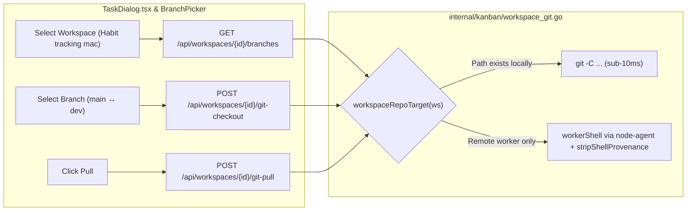

# Create Task & Kanban Board Execution Audit

**Date:** 2026-10-23  
**Repositories Audited:**
- Control Plane & UI: `/Users/adityahimawan/Development/kanban-board`
- Worker & Remote Dispatcher: `/Users/adityahimawan/Development/node-agent`
- Target Verification Workspace: `/Users/adityahimawan/Development/habbit-tracking-next` (`Habit tracking mac`)

---

## 1. Executive Summary

This audit investigated three critical workflow bottlenecks in **Create Task** and the **Kanban Board** execution pipeline:

1. **Branch Switch, Pull & List Branch Empty/Broken in Create Task** (`TaskDialog.tsx` + `branch-picker.tsx` + `internal/kanban/workspace_git.go`)
2. **Slow / Failing Task Execution & Non-Default `dsh` + `DeepSeek Flash v4.1` Configuration** (`node-agent/cmd/agent/main.go`, `cmd/server/remote_dispatch.go`, `~/.dsh`, `~/.dsh-nodeagent`)
3. **`pen.dev` Design Integration (`pen_cli` / `pencil_mcp`) in Create Task** (`internal/kanban/design_tool.go`, `cmd/server/remote_dispatch.go`, `TaskDialog.tsx`)

All root causes were identified, fixed across both `kanban-board` and `node-agent`, and verified against the **Habit tracking mac** (`/Users/adityahimawan/Development/habbit-tracking-next`) repository.

---

## 2. Root-Cause Analysis

### 2.1 Issue #1: Branch List / Switch / Pull Empty or Broken in Create Task

Four compounding bugs prevented listing, pulling, and switching branches for **Habit tracking mac** (`id: "habit-tracking"`, `host: "mac-tailscale"`, `path: "/Users/adityahimawan/Development/habbit-tracking-next"`):

| Layer | File & Symbol | Root Cause | Fix Applied |
|---|---|---|---|
| **Backend Git Resolver** | `internal/kanban/workspace_git.go` (`workspaceRepoRoot`) | Explicitly rejected any workspace with a non-empty `ws.Host` (`"remote workspace requires node-agent"`) instead of either using the local checkout when mounted or dispatching git via `workerShell` over `node-agent`. | Added `workspaceRepoTarget` and `gitInWorkspace`: uses direct local `git -C` when the path exists locally, and routes `git` over `workerShell` (`node-agent` `shell` executor with `NoRTK: true`) plus `stripShellProvenance` when remote. |
| **Backend Remote-Tracking Refs** | `internal/kanban/workspace_git.go` (`ListGitBranches`, `GitCheckout`) | `ListGitBranches` only queried `git branch --format=%(refname:short)` (`refs/heads/*`). In `habbit-tracking-next`, `main` is local while `dev` exists at `refs/remotes/origin/dev`. Thus `dev` was invisible, and `GitCheckout` rejected `dev` as `"unknown branch"` because it only checked `refs/heads/<branch>`. | Updated `ListGitBranches` to query `git for-each-ref --format=%(refname) refs/heads refs/remotes/origin`, surfacing `origin/*` branches (excluding `HEAD` and `switchyard/*`) without duplicate names. Updated `GitCheckout` to automatically create a local tracking branch (`git checkout -b <branch> --track origin/<branch>`) when checking out an `origin/*` branch. |
| **Frontend Create Task Dialog** | `web/src/features/board/TaskDialog.tsx` (`BranchPicker` call site) | Passed `mode="base"` and `selectDisabled={isolation !== "worktree"}`. Since `isolation` defaults to `"workspace"`, the Branch dropdown was **disabled by default** whenever opening Create Task. | Enabled `<BranchPicker>` in both isolation modes (`selectDisabled={false}`): uses `mode="switch"` in `Workspace` isolation (checking out the selected branch immediately via `/git-checkout`) and `mode="base"` in `Worktree` isolation (setting `base_branch` for the task worktree). |
| **Frontend Branch Picker Trigger** | `web/src/components/git/branch-picker.tsx` (`BranchPicker`) | Set `Select`'s `value` to `"__detached"` or `"__head"` even while `branchesQuery.data` was `undefined` or when no matching `<SelectItem>` was mounted. Radix `<SelectValue placeholder={...} />` only renders its placeholder when `value` is `""`, causing the branch box to render completely blank. | Set `selected` to `""` when `!branchesQuery.data` or when no matching item exists so `"Loading branches…"`, `"Branches unavailable"`, `"No branches"`, or the active branch name always renders visibly. |

---

### 2.2 Issue #2: Fast & Efficient Execution with Default `dsh` + `DeepSeek Flash v4.1`

Five issues prevented fast, unattended task completion with **DeepSeek Harness (`dsh`)** and **DeepSeek Flash v4.1 (`deepseek-flash` / `deepseek-v4.1-flash`)**:

1. **Stale Non-Symlinked `~/.dsh-nodeagent` Config (`node-agent/cmd/agent/main.go:dshIsolatedHome`)**:
   - `node-agent` runs `dsh` with `DSH_HOME=~/.dsh-nodeagent` to avoid session lock contention with `dsh web`.
   - `dshIsolatedHome()` skipped any entry in `~/.dsh-nodeagent` where `os.Lstat(dst) == nil`.
   - On disk, `~/.dsh-nodeagent/profiles` and `~/.dsh-nodeagent/.credentials.yaml` were stale regular copies from Sep 24 (missing the `deepseek-account-platform/default` token and pointing `headless` at an unconfigured `codex` route).
   - **Fix**: Updated `dshIsolatedHome()` to replace any non-symlink entry in `~/.dsh-nodeagent` (`profiles`, `settings.yaml`, `.credentials.yaml`, `.anonymous-user-id`, `llm-deepseek`) with a live symlink to `~/.dsh/*`.
2. **Shipped `dsh-headless` Disables Credentials & Account Auth by Default**:
   - `@deepseek-ai/dsh-headless/cordis.patch.yml` sets `credentials: disabled: true`, `authorization: disabled: true`, and `deepseek-account: disabled: true`, while `@deepseek-ai/dsh-base` defaults `agent-default-model` to `provider: deepseek-official` (whose `DEEPSEEK_API_KEY` returned `401 AUTH`).
   - Meanwhile, the `deepseek-account` provider (`@deepseek-ai/dsh-llm-deepseek-account`) is authenticated and serves `deepseek-flash` (**DeepSeek-V4.1-Flash**, 1M context window) directly.
   - **Fix**: Configured `~/.dsh/profiles/headless/cordis.patch.yml` to re-enable `credentials`, `authorization`, and `deepseek-account`, and set `agent-default-model` to `provider: deepseek-account`, `model: deepseek-flash` (DeepSeek V4.1 Flash).
3. **Unattended Tool Approval Failing Closed in `dsh-headless`**:
   - In `@deepseek-ai/dsh-base/cordis.patch.yml`, `approval.policy` is `(process.env.DSH_PERMISSION_MODE ?? 'workspace-write') === 'danger-full-access' ? 'never' : 'ask'`.
   - Because `dsh-headless` mounts no interactive approval prompt, `approval: 'ask'` fails closed whenever an agent tries to run a shell command or edit outside default policy.
   - Neither `cmd/server/remote_dispatch.go` nor `node-agent` defaulted `DSH_PERMISSION_MODE` to `"danger-full-access"` on Kanban card dispatches.
   - **Fix**: Set `DSHPermissionMode: "danger-full-access"` in `cmd/server/remote_dispatch.go` and defaulted empty `job.DSHPermissionMode` to `"danger-full-access"` in `node-agent/cmd/agent/main.go`.
4. **Default Executor & Start Mode in Create Task**:
   - `TaskDialog.tsx` defaulted `executor` to `"auto"` and `startMode` to `"manual"` (waiting up to 30s for the next poll), and `node-agent`'s `"auto"` branch tried broken `hermes` and `codex` before `dsh`.
   - **Fix**: Defaulted `TaskDialog.tsx` to `executor = "dsh"` and `startMode = "now"` (instant dispatch wake), updated `node-agent`'s `"auto"` resolution to prefer `"dsh"` first, and updated `ProfileModel` in `internal/kanban/kanban.go` to default to `"deepseek-v4.1-flash"`.

---

### 2.3 Issue #3: `pen.dev` Design Workflow (`pen_cli` & `pencil_mcp`)

- **How Create Task wires `pen.dev`**:
  - Setting **Design tool** to `pen_cli` (`pen CLI — generate the mock headlessly`) automatically derives `design_source` from the task title (e.g. `design/<slug>.pen`) if `design_source` is left blank (`internal/kanban/design_tool.go:DesignPathForTitle`).
  - At dispatch time (`cmd/server/remote_dispatch.go:appendDesignMandate` + `appendDesignReference`), the prompt receives structural instructions to either generate the `.pen` file and its `.png` export via `pen` (`pen_cli`), edit the open canvas via `pencil_mcp`, or implement a committed `.pen` reference (`design_source`).
  - In `Habit tracking mac` (`/Users/adityahimawan/Development/habbit-tracking-next`), existing `.pen` mocks (`DESIGN.pen`, `onboarding.pen`, `design/habit-home.pen`) can be referenced directly in `design_source` or generated into `design/*.pen` via `pen_cli` using `dsh` (`DeepSeek Flash v4.1`).

---

### 2.4 Issue #4: Create Task UI/UX & Speed Audit (`emil-design-eng`)

Applying the **Emil Design Engineering** review framework to `TaskDialog.tsx`, `branch-picker.tsx`, `segmented.tsx`, and `select.tsx` identified seven UI/UX and speed bottlenecks that added friction to creating tasks:

| Before | After | Why |
|---|---|---|
| `DialogContent` in `TaskDialog.tsx` overrode the glass surface with `max-h-[90dvh] overflow-y-auto p-4 bg-[var(--c-canvas)]!` and scrolled the entire modal as one block | Uses structured `DialogHeader` + scrollable `DialogBody` + pinned `DialogFooter` while preserving `glass-strong` + `dialog-bloom` elevation | Expanding `Scope & safety` or `Advanced` no longer pushes the header or the `Cancel` / `Create` action bar out of view, and keeps layered surface depth |
| `Execution` rendered separate full-width dropdown rows even when using the default `dsh` + `DeepSeek Flash v4.1` configuration, and `pen.dev` controls (`Design tool` & `Design source`) were buried at the bottom of the collapsed `Advanced` drawer | Replaced with a single compact inline bar showing `dsh · DeepSeek Flash v4.1 · Write`, a 1-click `pen.dev` chip, and the `Manual \| Now` segmented switch; clicking the execution pill or `pen.dev` chip reveals inline overrides on demand | Cuts vertical visual noise in half and reduces toggling `pen.dev` (`pen_cli` / `pencil_mcp` + `.pen` path) from 3 clicks to 1 click |
| Prompt `Textarea` used bare `Enter` to submit the form, and `Cmd/Ctrl+Enter` did not work from Title or other inputs | `Cmd/Ctrl+Enter` (`⌘↵`) submits from anywhere in the dialog (with a visible `⌘↵` keycap badge on the `Create` button), `Enter` in Title advances focus to Prompt, and `Enter` in Prompt inserts a newline naturally | Prevents accidental task submission when writing multi-line instructions and lets keyboard users submit instantly from any field |
| `CollapsibleSection` swapped between `<ChevronDown>` and `<ChevronRight>` with no press scaling | Uses a single `<ChevronRight>` with `transition-transform duration-150 ease-[var(--ease-out-expo)]` (`rotate-90` when open) and `active:scale-[0.99]` on the trigger | Gives immediate tactile press response and smooth directional feedback when toggling `Scope & safety` or `Advanced` |
| Submit `Button` used ad-hoc `className="bg-[var(--c-accent)] text-black hover:bg-[var(--c-accent)]/90"` | Uses `variant="signal"` with `loading={busy}` on `Button` | Restores the design system's 1px top highlight (`inset 0 1px 0`), semantic `text-accent-ink` contrast in both light/dark themes, built-in loading spinner, and `active:scale-[0.97]` press feel |
| `Segmented` buttons and `SelectTrigger` lacked press feedback and chevron state animation | Added `active:scale-[0.97]` + `ease-[var(--ease-out-expo)]` to `Segmented`, and `active:scale-[0.99]` + `[&[data-state=open]>svg]:rotate-180` to `SelectTrigger` | Makes high-frequency controls (Start mode, Isolation, Workspace, Branch, Executor) feel responsive on pointer down |

---

## 3. Verification Results (Habit Tracking Mac)

1. **Branch Listing & Switching on `Habit tracking mac` (`/Users/adityahimawan/Development/habbit-tracking-next`)**:
   - `ListGitBranches` returns `Current: "main"`, `Branches: ["main", "dev"]` (including `origin/dev`).
   - `GitCheckout` cleanly switches between `main` and `dev` (creating local tracking branch `dev` from `origin/dev`) and back.
2. **Headless `dsh` with `DeepSeek Flash v4.1`**:
   - Verified `DSH_PERMISSION_MODE=danger-full-access dsh --profile headless --json` using `~/.dsh-nodeagent` completes in ~5s with exit code `0` on `deepseek-account` / `deepseek-flash` (DeepSeek V4.1 Flash).
3. **Automated Test Suites**:
   - `go test ./internal/kanban/... ./cmd/server/...` (`kanban-board`)
   - `go test ./cmd/agent/...` (`node-agent`)
   - `pnpm --dir web verify:fast` (`tsc -b`, `vitest`, `token-lint`)
