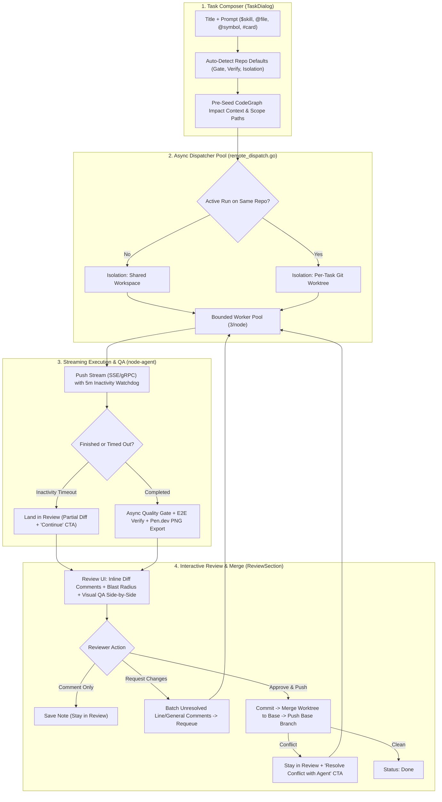

# Switchyard Kanban Flow Audit & Full-Stack Upgrade Specification

> **Purpose**: This specification is a self-contained implementation blueprint for autonomous coding agents and engineers. Every workstream includes exact file paths, line numbers, SQL migrations, API contracts, and drop-in Go/TypeScript patches so each phase can be implemented and verified independently.

---

## 1. Executive Summary & Audit Findings

An end-to-end audit of `kanban-board` (`cmd/server`, `internal/kanban`, `web/src`) and `node-agent` (`cmd/agent/main.go`) surfaced **10 structural bottlenecks** across task creation, dispatch, execution, review, and feedback loops:

| # | Severity | Bottleneck / Gap | Evidence (`file:line`) | Upgrade Resolution |
| :- | :--- | :--- | :--- | :--- |
| **1** | **P0** | **Serial Blocking Dispatcher**: `dispatchPendingRemoteTasks()` calls `kanban.DispatchRemote` synchronously inline (blocking 10–20 min per task) and then runs quality gate + UI verify inline. One slow task freezes every card on every board. | `cmd/server/remote_dispatch.go:349-371` | **WS-1**: Bounded async worker pool (default 3 concurrent jobs per node) + non-blocking gate/verify pipeline. |
| **2** | **P0** | **Every Comment Triggers Full Re-run**: `AddComment()` unconditionally moves any `review` or `blocked` card back to `todo` and wakes the dispatcher—even when the reviewer is just leaving a note or question. Comments posted mid-run also force an immediate re-run on completion. | `internal/kanban/comments.go:155-181`, `internal/kanban/nodeagent.go:594` | **WS-2**: Split into `intent: "comment"` (no requeue) vs `intent: "request_changes"` (batches all unresolved comments + line-level diff comments into a single structured re-run). |
| **3** | **P0** | **Lossy Cold Re-runs & Redundant AI Calls**: Non-continuity executors (`auto`, `hermes`, `codex`, `shell`) re-send the full prompt, truncate `previous_result` at 800 chars, include only the last 5 comments, and re-run `IdentifyTask` (an LLM call) on every single dispatch. | `cmd/server/remote_dispatch.go:200-260` | **WS-3**: Structured **Task Context Pack** (original goal, git diff stat/patch summary, full structured last result, unresolved review threads, gate/verify failure digest) + cached `task_identity` per task. |
| **4** | **P0** | **Fixed 600s Timeout & Hard Auto-Block**: Fixed 10m timeout kills long `pen.dev` or multi-file runs; a second timeout on non-continuation permanently blocks the card (`repeated timeout on continuation`). | `cmd/server/remote_dispatch.go:161-164`, `internal/kanban/nodeagent.go:1067` | **WS-4**: Activity-based heartbeat timeout (kill only after 5m of zero output, 60m hard cap). Timed-out runs land in `review` with partial diff + a one-click **Continue** action. |
| **5** | **P1** | **Silent Worktree Conflict & Wrong Push Target**: In `handleTaskApprove`, `commit_push` runs `git push` inside the worktree branch *before* `mergeWorktreeBack` merges into base. Base branch is never pushed. | `cmd/server/review.go:465-513` | **WS-5**: Auto-isolation (workspace when idle, worktree when concurrent), merge into base *before* pushing base branch, and a **Resolve Conflict with Agent** action when merge fails. |
| **6** | **P1** | **20-Field Create Task Form Overload**: `TaskDialog.tsx` exposes ~20 state variables; users must manually configure isolation, verify profile, gate command, and raw path globs. | `web/src/features/board/TaskDialog.tsx:195-245` | **WS-6**: Streamlined 4-core-field composer (`Title`, `Prompt` with `$skill` & `@` picker, `Workspace`, `Executor + Model` chip row) + collapsible `More` section with repo-inferred defaults & per-board memory. |
| **7** | **P1** | **No `@file` / `@symbol` / `#card` Context Picker**: No fuzzy file search or CodeGraph symbol query API exists for referencing code in prompts or review comments. | `cmd/server/workspace_file_routes.go:27`, `internal/kanban/codegraph.go:84` | **WS-7**: Unified `@` Omnibox Picker (`Files` via `git ls-files` fuzzy endpoint, `Symbols` via `codegraph`, `Cards` via board tasks) that auto-populates `paths` scope and injects context into the prompt. |
| **8** | **P1** | **1-Second HTTP Polling Per Running Task**: Control plane polls `/api/results/{id}` and progress every 1s per task instead of pushing over the existing stream/SSE channel. | `internal/kanban/nodeagent.go:929-934` | **WS-8**: Push-based node-agent stream → control-plane event bus → browser SSE stream (`/api/events`), keeping HTTP poll only as a fallback. |
| **9** | **P2** | **Disconnected CodeGraph, Pen.dev & E2E Review Loop**: CodeGraph isn't used to pre-seed task context or show blast radius in review; reviewers can't leave inline diff comments or compare `pen.dev` mocks against E2E screenshots side-by-side. | `cmd/server/review.go:636`, `web/src/features/board/ReviewSection.tsx` | **WS-9**: CodeGraph blast-radius badge & prompt pre-seeding, inline diff review comments (`file:line`), and side-by-side Visual QA (`pen.dev` PNG vs Playwright E2E screenshot + pixel-diff score). |

---

## 2. Target End-to-End Architecture



---

## 3. Workstream Implementation Specifications & Patches

### WS-1: Async Non-Blocking Dispatcher & Per-Node Worker Pool

#### Problem
In `cmd/server/remote_dispatch.go:117-375`, `dispatchPendingRemoteTasks()` iterates over pending cards and calls `kanban.DispatchRemote(...)` synchronously on line 349. While one task runs (up to 20 minutes) and runs `runQualityGate` + `runTaskVerify`, no other card on any board can be claimed or dispatched. Additionally, `MigrateBoardSchemaPublic` runs on every 30s tick for every board (`remote_dispatch.go:132`).

#### Solution
1. Cache migrated board slugs in memory (`migratedBoards sync.Map`) so schema migration runs once per board per server boot.
2. Introduce a per-node concurrency semaphore (`nodeSemaphores`, default `maxConcurrentPerNode = 3`, configurable via `KANBAN_MAX_CONCURRENT_PER_NODE`) and an `inFlightTasks sync.Map` guard so the dispatcher claims and spawns each task in its own goroutine without blocking the poll loop.
3. Run `CaptureDesignExport`, `runQualityGate`, and `runTaskVerify` inside the task's goroutine so completion transitions happen asynchronously.

#### Files to Modify
- `cmd/server/remote_dispatch.go` (`startRemoteDispatcher`, `dispatchPendingRemoteTasks`, extract `dispatchSingleCandidate`)

#### Patch (`cmd/server/remote_dispatch.go`)
```diff
--- a/cmd/server/remote_dispatch.go
+++ b/cmd/server/remote_dispatch.go
@@ -6,6 +6,8 @@ import (
 	"database/sql"
 	"fmt"
 	"log"
+	"os"
+	"strconv"
 	"strings"
+	"sync"
 	"time"
 
 	"kanban-board/internal/kanban"
@@ -43,6 +45,39 @@ func harnessLabel(executor string) string {
 	}
 }
 
+var (
+	inFlightTasks  sync.Map // map[taskID string]bool
+	migratedBoards sync.Map // map[boardSlug string]bool
+	nodeSemMu      sync.Mutex
+	nodeSemaphores = map[string]chan struct{}{}
+)
+
+func maxConcurrentPerNode() int {
+	if v, err := strconv.Atoi(strings.TrimSpace(os.Getenv("KANBAN_MAX_CONCURRENT_PER_NODE"))); err == nil && v > 0 {
+		return v
+	}
+	return 3
+}
+
+func nodeSemaphore(sshTarget string) chan struct{} {
+	key := strings.TrimSpace(sshTarget)
+	if key == "" {
+		key = "default-node"
+	}
+	nodeSemMu.Lock()
+	defer nodeSemMu.Unlock()
+	sem, ok := nodeSemaphores[key]
+	if !ok {
+		sem = make(chan struct{}, maxConcurrentPerNode())
+		nodeSemaphores[key] = sem
+	}
+	return sem
+}
+
+func ensureBoardMigratedOnce(slug string) error {
+	if _, ok := migratedBoards.Load(slug); ok {
+		return nil
+	}
+	if _, err := kanban.MigrateBoardSchemaPublic(slug); err != nil {
+		return err
+	}
+	migratedBoards.Store(slug, true)
+	return nil
+}
```

And in `dispatchPendingRemoteTasks()` (`cmd/server/remote_dispatch.go:117-375`):
```go
// Replace lines 128-136 with:
if mErr := ensureBoardMigratedOnce(b.Slug); mErr != nil {
	log.Printf("remote-dispatcher: board %s: schema migration failed: %v", b.Slug, mErr)
	db.Close()
	continue
}

// Inside `for _, r := range pending`:
if _, alreadyRunning := inFlightTasks.LoadOrStore(r.id, true); alreadyRunning {
	continue
}
sem := nodeSemaphore(r.sshTarget)
select {
case sem <- struct{}{}:
	// Acquired concurrency slot for this node
default:
	// Node is at max concurrency; leave task in todo/ready for next wake
	inFlightTasks.Delete(r.id)
	continue
}

// After ClaimTaskRunGuarded and EnsureTaskWorktree succeed, run the blocking wait + QA in a goroutine:
go func(boardSlug string, cand dispatchCandidate, dispatchReq kanban.NodeDispatchRequest, workWS, effDesign string) {
	defer func() {
		<-sem
		inFlightTasks.Delete(cand.id)
		// Wake dispatcher so any queued card waiting for a slot starts immediately
		kanban.WakeDispatcher()
	}()
	_, err := kanban.DispatchRemote(dispatchReq, kanban.RemoteDispatchWaitForTask(cand.executionMode, cand.designTool))
	if effDesign != "" {
		kanban.CaptureDesignExport(boardSlug, cand.id, workWS, effDesign)
	}
	if err != nil {
		log.Printf("remote-dispatcher: %s failed: %v", cand.id, err)
		return
	}
	log.Printf("remote-dispatcher: %s completed", cand.id)
	runQualityGate(boardSlug, cand.id, workWS, cand.title, cand.gateCommand)
	runTaskVerify(boardSlug, cand.id, workWS, cand.title, cand.verifyProfile, effDesign)
}(b.Slug, r, req, workWorkspace, effectiveDesignSource)
```

---

### WS-2: Explicit Review Semantics (`Comment` vs `Request Changes`) + Inline Diff Comments

#### Problem
1. `internal/kanban/comments.go:155`: Any comment on a `review` or `blocked` task immediately flips `status='todo'` and triggers a full agent run.
2. `internal/kanban/nodeagent.go:594`: If a user posts a comment while a task is `running`, `Finalize` sees a new comment and immediately requeues the task to `todo` instead of letting it land in `review`.
3. Reviewers cannot anchor comments to specific lines in the diff (`file_path` + `line_number`).

#### Database Schema Migration (`internal/kanban/kanban.go` in `MigrateBoardSchema`)
Add columns to `task_comments`:
```sql
ALTER TABLE task_comments ADD COLUMN intent TEXT NOT NULL DEFAULT 'comment'; -- 'comment' | 'request_changes'
ALTER TABLE task_comments ADD COLUMN file_path TEXT NOT NULL DEFAULT '';
ALTER TABLE task_comments ADD COLUMN line_number INTEGER NOT NULL DEFAULT 0;
ALTER TABLE task_comments ADD COLUMN resolved INTEGER NOT NULL DEFAULT 0;
```

#### Backend Changes (`internal/kanban/comments.go` & `cmd/server/boards_routes.go`)
Update `TaskComment` struct and `AddCommentWithOptions`:
```go
type TaskComment struct {
	ID         int64  `json:"id"`
	TaskID     string `json:"task_id"`
	Author     string `json:"author"`
	Body       string `json:"body"`
	Intent     string `json:"intent"`                // "comment" | "request_changes"
	FilePath   string `json:"file_path,omitempty"`   // optional diff file anchor
	LineNumber int    `json:"line_number,omitempty"` // optional 1-based line number
	Resolved   bool   `json:"resolved"`
	CreatedAt  int64  `json:"created_at"`
	Requeued   bool   `json:"requeued,omitempty"`
}

type CommentInput struct {
	Author     string `json:"author"`
	Body       string `json:"body"`
	Intent     string `json:"intent"` // "comment" (default) | "request_changes"
	FilePath   string `json:"file_path,omitempty"`
	LineNumber int    `json:"line_number,omitempty"`
}
```

In `AddCommentWithOptions` (`internal/kanban/comments.go:153-171`):
- Only transition `status` (`review`/`blocked`/`done`) → `todo` when `input.Intent == "request_changes"` OR the comment explicitly contains `@<assignee>` with action intent.
- When `input.Intent == "comment"`, insert the comment, broadcast `"commented"`, and **keep the task in its current status (`review`)**.
- Add `POST /api/boards/{slug}/tasks/{id}/request-changes` (or pass `intent: "request_changes"` to `POST /api/boards/{slug}/tasks/{id}/comments`) which marks all current unresolved comments as the active feedback batch, transitions `review` → `todo`, and calls `WakeDispatcher()`.

In `internal/kanban/nodeagent.go:594`:
- Remove the auto-requeue on ordinary mid-run comments; only requeue if an explicit `intent = 'request_changes'` comment arrived after `started_at`.

#### Frontend Changes (`web/src/features/board/DiscussionPanel.tsx` & `ReviewSection.tsx`)
1. In the discussion composer (`DiscussionPanel.tsx`), when `task.status === "review"` or `"blocked"`, render two distinct submit buttons:
   - **Comment** (secondary button, `⌘↵` default when typing a note): sends `intent: "comment"`. Task stays in `review`.
   - **Request Changes & Re-run** (amber/accent button, `⌘⇧↵`): sends `intent: "request_changes"`, batching any pending inline diff comments + the summary comment into one agent turn.
2. In the diff viewer (`ReviewSection.tsx`), clicking the `+` gutter icon on any diff line opens an inline comment box that saves a `TaskComment` with `file_path`, `line_number`, and `intent: "comment"`. A top bar badge shows `N pending review comments` with a **Request Changes (N)** button to trigger the single batched re-run.

---

### WS-3: Structured "Task Context Pack" for Cold Re-runs & Cached `IdentifyTask`

#### Problem
1. When `sessionContinuation` is false (`auto`, `hermes`, `codex`, `shell`, or when a session binding expired), `remote_dispatch.go:200-226` truncates `r.result` to 800 characters and appends only the last 5 comments in raw `@author: body` format.
2. `kanban.IdentifyTask(context.Background(), r.title, r.body)` (`remote_dispatch.go:247`) is called on every dispatch pass even if `task_identity` was already computed and persisted on the first run.

#### Solution
1. **Cache `TaskIdentity`**: In `remote_dispatch.go:247`, first check `kanban.LoadTaskIdentity(db, r.id)`. Only call `kanban.IdentifyTask` if no persisted identity exists or `r.title`/`r.body` hash changed.
2. **Build `BuildColdRerunContextPack`**: Replace lines 200–226 in `cmd/server/remote_dispatch.go` with `kanban.BuildColdRerunContextPack(db, r.id, workWorkspace, r.title, r.body, r.result)`:

```go
// internal/kanban/context_pack.go
package kanban

import (
	"database/sql"
	"fmt"
	"os/exec"
	"strings"
)

// BuildColdRerunContextPack assembles a lossless, structured prompt for re-runs
// when native harness session continuation is unavailable.
func BuildColdRerunContextPack(db *sql.DB, taskID, workspace, title, originalBody, lastResult string) string {
	var b strings.Builder
	b.WriteString("[CONTINUATION — STRUCTURED CONTEXT PACK]\n")
	b.WriteString("You are resuming an existing task in the workspace after reviewer feedback or a previous attempt.\n")
	b.WriteString("Do NOT redo completed work from scratch; inspect the current workspace diff and address the unresolved items below.\n\n")

	b.WriteString("## 1. Original Task Specification\n")
	b.WriteString("Title: " + strings.TrimSpace(title) + "\n")
	if strings.TrimSpace(originalBody) != "" {
		b.WriteString(strings.TrimSpace(originalBody) + "\n")
	}

	// 2. Current Git Diff Stat in Workspace
	if workspace != "" {
		if out, err := exec.Command("git", "-C", workspace, "diff", "--stat", "HEAD").Output(); err == nil && len( strings.TrimSpace(string(out))) > 0 {
			b.WriteString("\n## 2. Uncommitted Workspace Changes (git diff --stat)\n```\n")
			b.WriteString(strings.TrimSpace(string(out)))
			b.WriteString("\n```\n")
		}
	}

	// 3. Structured Summary of Previous Attempt
	if strings.TrimSpace(lastResult) != "" {
		b.WriteString("\n## 3. Previous Run Output Summary\n")
		b.WriteString( summarizePreviousResult(lastResult, 3200) + "\n")
	}

	// 4. Last Gate / Verify Failure Digest (if any)
	var gateStatus, gateOutput, verifyStatus, verifyReport string
	_ = db.QueryRow(`SELECT COALESCE(gate_status,''), COALESCE(gate_output,''), COALESCE(verify_status,''), COALESCE(verify_report,'') FROM tasks WHERE id=?`, taskID).
		Scan(&gateStatus, &gateOutput, &verifyStatus, &verifyReport)
	if gateStatus == "failed" && gateOutput != "" {
		b.WriteString("\n## 4. Quality Gate Failure to Fix\n```\n" + tailString(gateOutput, 1500) + "\n```\n")
	}
	if verifyStatus == "failed" && verifyReport != "" {
		b.WriteString("\n## 5. Verification Failure to Fix\n```\n" + tailString(verifyReport, 1500) + "\n```\n")
	}

	// 5. All Unresolved Review Comments (including file:line anchors)
	comments, _ := UnresolvedTaskComments(db, taskID)
	if len(comments) > 0 {
		b.WriteString("\n## 6. Unresolved Reviewer Feedback (Action Required)\n")
		for i, c := range comments {
			loc := ""
			if c.FilePath != "" {
				loc = fmt.Sprintf(" [%s:%d]", c.FilePath, c.LineNumber)
			}
			fmt.Fprintf(&b, "%d. @%s%s: %s\n", i+1, c.Author, loc, strings.TrimSpace(c.Body))
		}
	}
	return b.String()
}
```

---

### WS-4: Activity-Based Watchdog Timeout & Graceful Partial-Review Landing

#### Problem
1. `node-agent/cmd/agent/main.go:518` and `internal/kanban/nodeagent.go:1067` enforce a rigid wall-clock timeout (600s default, 1200s agentic). If an agent is actively making progress on a large UI + `pen.dev` task at minute 11, it is killed with `node_agent_job_timeout`.
2. On the next run, `cmd/server/remote_dispatch.go:161` sees `strings.HasPrefix(r.lastError, "node_agent_job_timeout:")` and permanently moves the task to `blocked`.

#### Solution
1. **Inactivity Watchdog in `node-agent`** (`node-agent/cmd/agent/main.go`):
   - Track `lastActivityUnixNano` atomic timestamp updated whenever stdout/stderr/progress emits bytes.
   - Replace the single wall-clock timer with:
     - `InactivityTimeoutS` (default `300s` / 5 minutes of zero output)
     - `HardCeilingTimeoutS` (default `3600s` / 60 minutes maximum wall-clock safety cap)
   - Include `InactivityTimeoutS int` in `NodeDispatchRequest` (`internal/kanban/nodeagent.go`).
2. **Graceful Partial Landing in `review`**:
   - When a job exits with `inactivity_timeout` or `job_timeout` **and** the workspace has uncommitted changes (`git status --porcelain` is non-empty) or a `.pen` export was produced:
     - Transition the task to `review` (not `blocked`) with `last_failure_error = "timed_out_partial: paused after inactivity; partial changes ready for review or continuation"`.
     - Remove the hard auto-block check at `cmd/server/remote_dispatch.go:161-164`.
   - In `ReviewSection.tsx`, when `task.last_failure_error` starts with `timed_out_partial:`, show an amber banner: **"Run paused after timeout — partial changes are shown below"** with a primary **Continue Run** button that requeues the card using session continuation (or the WS-3 Context Pack).

---

### WS-5: Auto-Isolation & Safe Worktree Merge / Conflict Resolution Loop

#### Problem
1. Users have to manually choose `Workspace` vs `Worktree` in the Create Task form.
2. In `cmd/server/review.go:465-513`, when approving a worktree-isolated task with `commit_push`:
   - Line 466 appends `&& git push` to the commit script that runs **inside the worktree** (`t.WorktreePath`), pushing the temporary worktree branch (`switchyard/t_xxxx`) instead of the base branch!
   - Line 507 then runs `mergeWorktreeBack(t)` into `t.WorkspacePath`, and **never pushes the merged base branch**.
   - If `mergeWorktreeBack` fails with a conflict, the reviewer has no one-click way to let the agent resolve the merge conflict.

#### Solution
1. **Automatic Isolation Selection (`cmd/server/remote_dispatch.go:318`)**:
   - Default `isolation` to `"auto"`.
   - At dispatch time, query if any other task on the same `workspace_path` is currently in `status IN ('running', 'review')` with uncommitted changes.
   - If the workspace has another active task, automatically upgrade `isolation` to `"worktree"` via `EnsureTaskWorktree`. Otherwise, run directly in `"workspace"` for speed and zero worktree overhead.
2. **Fix Commit → Merge → Push Order in `cmd/server/review.go:465-520`**:
   ```diff
   --- a/cmd/server/review.go
   +++ b/cmd/server/review.go
   @@ -462,7 +462,7 @@ func handleTaskApprove(w http.ResponseWriter, r *http.Request) {
    	} else {
    		script = fmt.Sprintf("git add -A -- \"$scope\" && git commit -m %s", shellQuote(msg))
    	}
   -	if req.Action == "commit_push" {
   +	if req.Action == "commit_push" && t.WorktreePath == "" {
    		script += " && git push"
    	}
    	out, code := runGitFunc(t, reviewScopeSetup+script)
   @@ -504,11 +504,21 @@ func handleTaskApprove(w http.ResponseWriter, r *http.Request) {
    	if t.WorktreePath != "" {
    		if err := mergeWorktreeBack(t); err != nil {
    			log.Printf("approve: %s: merge back failed: %v", id, err)
    			kanban.RecordWorktreeMergeConflict(slug, id, err.Error())
    			fail(w, err, http.StatusConflict)
    			return
    		}
   +		if req.Action == "commit_push" {
   +			pushOut, pushErr := kanban.PushWorkspaceBaseBranch(t.WorkspacePath, t.BaseBranch)
   +			if pushErr != nil {
   +				fail(w, fmt.Errorf("merged into base branch, but git push failed: %v\n%s", pushErr, truncate(pushOut, 500)), http.StatusInternalServerError)
   +				return
   +			}
   +		}
    	}
   ```
3. **One-Click "Resolve Conflict with Agent" Endpoint**:
   - Add `POST /api/boards/{slug}/tasks/{id}/resolve-conflict` in `cmd/server/review.go`.
   - When clicked from the Review conflict banner (`ReviewSection.tsx`), it rebases/merges the base branch into the task's worktree (`git merge <base_branch>`), captures the conflicting file list (`git diff --name-only --diff-filter=U`), appends a structured conflict-resolution instruction comment, and wakes the dispatcher so the agent resolves the conflict markers and returns the card to `review`.

---

### WS-6: Streamlined Create Task Modal & Repo-Aware Smart Defaults

#### Problem
`web/src/features/board/TaskDialog.tsx` manages ~20 form controls. Most tasks only need a Title, a Prompt (with `$skill` and `@file`), a Workspace, and an Executor/Model choice.

#### Solution
1. **Primary View (4 Core Controls)**:
   - **Title** (`#task-title`)
   - **Prompt** (`#task-body`) with inline `$skill` autocomplete, `@` omnibox autocomplete (WS-7), attachment dropzone, and `Skill` / `@ File` / `Fast` / `Deep` header pills.
   - **Workspace** selector (auto-selected from board/live node).
   - **Compact Execution Bar**: Single horizontal pill row right below Workspace:
     - Executor pill (`DSH` / `Command Code` / `Auto`)
     - Model picker (`SearchSelect` with per-board `localStorage` memory: `switchyard:last-model:${slug}:${executor}`)
     - Effort pill (`Auto` / `Low` / `Medium` / `High` / `Max`)
     - Optional `Pen.dev` toggle pill (`Off` / `Pen CLI` / `Pencil MCP`)
2. **Single Collapsible `More Options` Drawer**:
   - Consolidates `Priority`, `Dependencies`, `Quality Gate`, `Verify Profile`, `Base Branch`, and `Execution Mode` into one clean accordion that stays closed by default.
   - **Remove `Isolation` toggle from UI** (handled automatically by WS-5, or kept as `Auto (Recommended)` inside `More Options`).
3. **Repo-Inferred Smart Defaults (`GET /api/workspaces/{id}/defaults`)**:
   - Inspects `package.json`, `go.mod`, `Cargo.toml`, `.e2e/e2e.config.ts` in the selected workspace and returns:
     - `suggested_gate_command` (e.g., `pnpm test -- --run` or `go test ./...`)
     - `suggested_verify_profile` (`ui` if `web/src` exists, else `fast`)

---

### WS-7: Unified `@` Omnibox Picker (`@file`, `@symbol`, `#card`)

#### Problem
Users cannot reference workspace files, CodeGraph symbols, or other board tasks inline while writing a task prompt or review comment.

#### Backend Endpoints to Add
1. **Fast Fuzzy File Search (`GET /api/workspaces/{id}/files/search?q=<query>&limit=20`)** in `cmd/server/workspace_file_routes.go`:
   - Runs `git -C <workspace_path> ls-files` (cached in memory for 30s per workspace) and ranks matches by:
     1. Exact basename prefix
     2. Substring match on basename
     3. Fuzzy subsequence / path substring match
2. **CodeGraph Symbol Search (`GET /api/workspaces/{id}/codegraph/symbols?q=<query>&limit=15`)** in `internal/kanban/codegraph.go`:
   - Executes `codegraph query "<q>" --json` (or parses `.codegraph` SQLite/index in the workspace) and returns `{ name, kind, file_path, line }` items.

#### Backend File Search Implementation (`internal/kanban/workspace_files.go`)
```go
type FileSearchMatch struct {
	Path      string `json:"path"`
	Basename  string `json:"basename"`
	Directory string `json:"directory"`
	Score     int    `json:"score"`
}

func SearchWorkspaceFiles(ws Workspace, query string, limit int) ([]FileSearchMatch, error) {
	if limit <= 0 || limit > 50 {
		limit = 20
	}
	allFiles, err := cachedGitTrackedFiles(ws)
	if err != nil {
		return nil, err
	}
	q := strings.ToLower(strings.TrimSpace(query))
	var matches []FileSearchMatch
	for _, rel := range allFiles {
		lower := strings.ToLower(rel)
		base := filepath.Base(lower)
		score := 0
		switch {
		case q == "":
			score = 1
		case base == q:
			score = 100
		case strings.HasPrefix(base, q):
			score = 80
		case strings.Contains(base, q):
			score = 60
		case strings.Contains(lower, q):
			score = 40
		default:
			continue
		}
		matches = append(matches, FileSearchMatch{
			Path:      rel,
			Basename:  filepath.Base(rel),
			Directory: filepath.Dir(rel),
			Score:     score,
		})
	}
	sort.Slice(matches, func(i, j int) bool {
		if matches[i].Score != matches[j].Score {
			return matches[i].Score > matches[j].Score
		}
		return len(matches[i].Path) < len(matches[j].Path)
	})
	if len(matches) > limit {
		matches = matches[:limit]
	}
	return matches, nil
}
```

#### Frontend `@` Picker (`web/src/components/ui/prompt-omnibox.tsx` + `TaskDialog.tsx` + `DiscussionPanel.tsx`)
- Extends the `$skill` cursor-tracking pattern in `TaskDialog.tsx:253`:
  - Typing `@` opens the floating glassmorphic popover with 3 tabs (`Tab` or `←/→` switches tabs, or unified list with badges):
    - **Files** (`@web/src/features/board/TaskDialog.tsx`): Selecting a file inserts `@path/to/file ` into the prompt **AND automatically adds `path/to/file` to the task's `paths` scope** so lease guarding and CodeGraph impact analysis know the exact target file!
    - **Symbols** (`@symbol:handleTaskApprove` in `cmd/server/review.go:340`): Inserts `@cmd/server/review.go#L340 (handleTaskApprove) ` and adds the file to `paths`.
    - **Cards** (`#t_9936fba1`): Typing `#` or selecting the `Cards` tab searches board tasks and offers to link as a dependency or reference.

---

### WS-8: Push-Based Node-Agent Stream & Real-Time Browser SSE

#### Problem
`internal/kanban/nodeagent.go:929-934` polls `/api/results/{id}` and progress every 1 second per running job over HTTP, and the dispatcher ticks every 30s.

#### Solution
1. **Node-Agent Push Callback (`POST /api/node-agent/events`)**:
   - In `node-agent/cmd/agent/main.go`, as the child process (`dsh`, `cmd`, `claude`, etc.) emits JSONL trace events or stdout lines, batch-flush every `250ms` (or immediately on state transition/completion) to the control plane over the persistent stream / HTTP push endpoint.
2. **Control Plane Event Bus (`internal/kanban/events.go`)**:
   - When `POST /api/node-agent/events` receives a progress frame or final result:
     - Immediately wakes `DispatchRemote` wait channel (`jobDoneCh[runID]`) instead of waiting for the 1s poll tick.
     - Broadcasts `task_progress` and `task_status` events over the existing SSE stream (`/api/events`) so `TaskDetailPage` and `OutputPanels` update in real time (<100ms latency).
   - Keep the 5s HTTP poll as a fallback in case a frame is dropped across a Tailscale reconnect.

---

### WS-9: CodeGraph-Aware Prompts, Blast Radius in Review & Visual QA Loop

#### Problem
1. CodeGraph indexes the workspace (`internal/kanban/codegraph.go`), but the index is never queried when dispatching a task or reviewing its diff.
2. When a task uses `pen.dev` and runs E2E UI verification, the reviewer has to inspect the `.pen` PNG attachment and E2E screenshots separately.

#### Solution
1. **CodeGraph Prompt Pre-Seeding (`internal/kanban/codegraph_context.go`)**:
   - Before dispatching a task in `remote_dispatch.go`, if the task has `@file` references, declared `paths`, or symbol names in the title/body, run a fast `codegraph context` lookup (3s timeout) to append a compact `--- CodeGraph Related Files & Callers ---` block (top 8 callers/callees + file paths) to the execution message.
2. **Blast Radius Badge in Review (`cmd/server/review.go` & `ReviewSection.tsx`)**:
   - In `GET /api/boards/{slug}/tasks/{id}/diff`, compute the set of modified functions/files and query CodeGraph for downstream dependents (`impacted_files_count`, `impacted_symbols`).
   - Display a **Blast Radius** pill in `ReviewGateBar.tsx` (e.g., `Low Impact · 2 callers` vs `High Impact · 19 callers across 7 files`), expandable to see the affected call graph.
3. **Visual QA Side-by-Side Comparison (`web/src/features/board/VisualQAComparison.tsx`)**:
   - When a card in `review` has both a `pen.dev` design export attachment (`*.pen.png`) and an E2E verification screenshot (`*.e2e.png`), render a dedicated **Visual QA** tab in `ReviewSection.tsx`:
     - Side-by-side / onion-skin slider comparing the `pen.dev` target design against the actual rendered Playwright screenshot.
     - Displays a pixel/structural similarity badge and allows clicking anywhere on the image to drop a pinned review comment (`intent: "request_changes"`).

---

## 4. Recommended Execution Order for Agents

| Phase | Workstreams | Can Run in Parallel? | Estimated Effort | Verification Gate |
| :- | :--- | :--- | :--- | :--- |
| **Phase 1: Core Reliability & Loop Fixes** | **WS-1** (Async Dispatcher Pool) + **WS-2** (`Comment` vs `Request Changes`) + **WS-5** (Auto-Isolation & Merge/Push Fix) | Yes (WS-1 in `remote_dispatch.go`, WS-2 in `comments.go`, WS-5 in `review.go`) | ~2–3 hours | `go test ./cmd/server/... ./internal/kanban/...` + `pnpm --dir web test -- --run` |
| **Phase 2: Context Quality & Watchdog** | **WS-3** (Cold Rerun Context Pack + Cached Identity) + **WS-4** (Inactivity Watchdog + Partial Review Landing) | Yes (`kanban-board` vs `node-agent`) | ~2 hours | `go test ./...` in both `kanban-board` and `node-agent` |
| **Phase 3: Composer UX & `@` Omnibox** | **WS-6** (Minimal Create Task Form + Smart Defaults) + **WS-7** (`@file`, `@symbol`, `#card` Omnibox) | Sequential (WS-7 plugs into WS-6's `TaskDialog.tsx`) | ~2–3 hours | `pnpm --dir web test -- --run` + `pnpm --dir web build` |
| **Phase 4: Streaming & Intelligence** | **WS-8** (Push Stream / SSE) + **WS-9** (CodeGraph Context + Blast Radius + Visual QA) | Yes | ~3 hours | Full E2E suite + live board verification |
